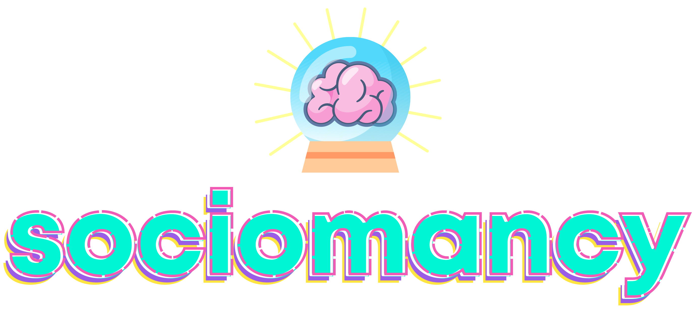
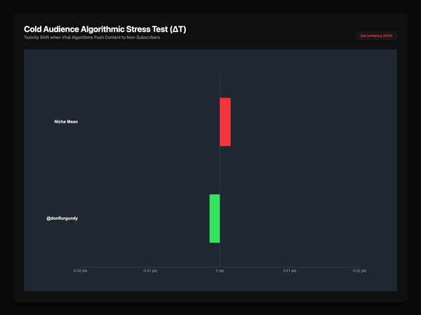

# Local AI Powered Social Media Analytics Engine

The library analyzes individual YouTube channels and, separately, topic-level trends across gaming and software news. The pipeline is designed to be extensible to other social media platforms.

> Catoptromancy is divination using a mirror. Sociomancy is a Portmanteau / Neologism for divination using Social Media. Clever Right? My other idea was "Crystal-Ballin". 

## Download | Analyze | Present

### YouTube Creator Analytics Pipeline

An end-to-end data processing and machine learning pipeline that fetches YouTube channel and comment data via the YouTube Data API v3, processes text through local ONNX Transformer models, and outputs statistical analytics on community health, audience retention depth, and engagement authenticity.



### Multi-channel Trend Analysis

This codebase also has the ability to pull in data from Reddit, Metacritic, Google Trends etc. and measure toxicity, perform keyword classification, and loads of other local AI powered analysis. Ideally everything the library does is local, and does not and will not require a paid account anywhere. Further more, the graphs that are created can either be static PNGs, or animated MP4 version, perfect for multimedia presentations. 

---

## QUICK START

All pipeline commands are managed via [`uv`](https://github.com/astral-sh/uv). Run the steps below in sequence to ingest channel data, run local ONNX model inferences, establish control benchmarks, and render animated ECharts visualizers.

### Prerequisites & Setup

Ensure `uv` is installed, then synchronize project dependencies and local environment:

```bash
uv sync
```

#### Step-by-Step Execution Sequence

1. Target Channel Ingestion & 5-Pillar Analysis
   Collects raw channel metadata/comments and runs local ONNX Transformer inference (RoBERTa, GoEmotions, BART-MNLI, HDBSCAN) to build the primary scorecard payload.

```bash
uv run sociomancy @donflurgundy
```

Outputs: `data/raw/donflurgundy.json` and `data/processed/donflurgundy_metrics.csv`

2. Peer Group Discovery
   Generates a candidate pool of peer channels in the same niche using semantic topic profiling (BAAI/bge-small-en-v1.5) and Jaccard audience overlap scoring.

```bash
uv run python src/sociomancy/discover.py donflurgundy
```

Outputs: `output_cards/donflurgundy/related.json`

3. Control Group BenchmarkingInfers 5-pillar metrics across discovered peer channels, calculates niche arithmetic means ($\mu$) and standard deviations ($\sigma$), and normalizes target channel performance into relative $Z$-scores.

```bash
uv run python src/sociomancy/benchmark.py donflurgundy --delay 3.0
```

Outputs: data/processed/donflurgundy_scorecard.json and data/processed/donflurgundy_benchmark.json

4. Generate Animated ECharts Visualizers
   Renders dark-themed Apache ECharts HTML/Jinja templates and exports them into high-bitrate animated .mp4 video files using Pyppeteer and MoviePy.

```bash
# Render animated MP4 chart videos
uv run python src/charts/build_charts.py donflurgundy

# (Optional) Add --png to render static high-res images instead
uv run python src/charts/build_charts.py donflurgundy --png
```

Outputs: `output_charts/donflurgundy/*.mp4` (or .png)

5. (Optional) Generate Channel Profile Cards
   Creates transparent PNG profile cards displaying fetched avatar imagery, channel banners, handles, and subscriber counts.

```bash
uv run python src/cards/build_cards.py path/to/channels.json -o ./output_cards
```

### Topic & Trend Pipeline

Independent of the channel steps above. Pulls a gaming and software news sample, overlays Google Trends and GDELT, and renders six charts. See [Topic & Trend Analysis](#topic--trend-analysis-4-acts).

```
uv run python src/sociomancy/youtube_algo_analyzer.py --with-onnx
uv run python src/charts/build_charts.py --topics
```

Outputs: `data/processed/topics/` and `output_charts/topics/*.mp4` (add `--png` for stills).

---

## Data Ingestion (Data Fetched)

The pipeline interacts with the **YouTube Data API v3** to collect raw datasets for a target creator as well as a pre-defined set of 10–15 niche benchmark channels (control group).

### 1. Channel Metadata

- Channel ID, title, creation date, total view count, subscriber count, total video count.

### 2. Video Metadata (Last 15–30 Uploads)

- Video ID, title, publish timestamp, view count, like count, total comment count.

### 3. Comment Data (Up to 500 Top Comments Per Video)

- Comment ID, video ID, publish timestamp, comment text, like count.
- Anonymized author metadata (`authorChannelId` / `authorDisplayName`).

---

## Computed Statistics & Analytical Methodology

The pipeline processes raw JSON payloads and converts unstructured comment text into quantitative metrics using local ONNX Runtime models (`optimum.onnxruntime`).

### 1. Empathy vs. Toxicity Index

- **Data Sources:** Comment text and `like_count` across last 10–15 videos[cite: 1, 3].
- **Models Used:**
  - `unitary/unbiased-toxic-roberta` (ONNX): Evaluates probability scores ($0.0 \text{ to } 1.0$) for toxicity, severe toxicity, insults, and identity attacks[cite: 1].
  - `SamLowe/roberta-base-go_emotions` (ONNX): Maps text across 28 discrete emotional categories (_admiration_, _gratitude_, _disapproval_, _annoyance_)[cite: 1].
- **Computed Output:**
  - **Baseline Sentiment:** Overall toxicity percentage (% of comments scoring $>0.5$ toxicity) and dominant emotional distribution[cite: 1].
  - **Top Comment Resonance Delta ($\Delta R_{\text{tox}}$):** Isolates the top $N$ most-liked comments per video upload to evaluate community endorsement dynamics:
    $$\Delta R_{\text{tox}} = \text{Toxicity}_{\text{Top Comments}} - \text{Toxicity}_{\text{Baseline}}$$
    _A negative $\Delta R_{\text{tox}}$ indicates the broader community actively upvotes empathetic/supportive comments and suppresses baseline noise.\_
  - **Relative $Z$-score:**
    $$Z_{\text{toxicity}} = \frac{X_{\text{channel}} - \mu_{\text{control}}}{\sigma_{\text{control}}}$$
    _Normalizes $\Delta R_{\text{tox}}$ relative to the control group’s average toxicity distribution.\_
  - **Interpretation:** A higher $Z_{\text{toxicity}}$ indicates the channel’s toxicity profile is more extreme relative to the control group.

### 2. Core Tribe Ratio

- **Data Sources:** `authorChannelId` array collected across all scraped video uploads.
- **Calculation:** Identifies repeat commenters to measure audience loyalty vs. one-time visitors.
  $$\text{Core Tribe Ratio (\%)} = \left( \frac{\text{Unique Authors with } \ge 3 \text{ Video Comments}}{\text{Total Unique Authors in Dataset}} \right) \times 100$$
- **Computed Output:** Percentage of active community members participating regularly across multiple uploads.

### 3. Parasocial Impact Density Score

- **Data Sources:** Comment text, character lengths, token variance, and `like_count`[cite: 1, 3].
- **Models Used:**
  - `facebook/bart-large-mnli` (ONNX): Zero-shot classification tagging text for personal disclosure intent (labels: `"Life Impact"`, `"Applied Skill"`, `"Emotional Support"`, `"Generic Praise"`)[cite: 1].
- **Computed Output:**
  - Average word count and token variance per comment[cite: 1].
  - Baseline disclosure rate expressed as `Impact Disclosures per 1,000 Comments`[cite: 1].
  - **Top Comment Parasocial Resonance Delta ($\Delta R_{\text{parasocial}}$):** Isolates top-voted comments to test if audience upvoting amplifies parasocial disclosures vs. surface-level noise:
    $$\Delta R_{\text{parasocial}} = \text{Parasocial Score}_{\text{Top Comments}} - \text{Parasocial Score}_{\text{Baseline}}$$
    _A positive $\Delta R_{\text{parasocial}}$ indicates the community actively rewards deep emotional connection, life impact disclosures, and vulnerability with high upvote counts.\_

```text
                         ┌──────────────────┐
                         │ YouTube Comment  │
                         └────────┬─────────┘
                                  │
                 ┌────────────────▼─────────────────┐
                 │ Text Normalize & language Detect │
                 └────────────────┬─────────────────┘
                                  │
            ┌─────────────────────┼────────────────────┐
            │                     │                    │
            ▼                     ▼                    ▼
       Regex Rules          Semantic Model       Emotion Model
       High Precision       Meaning/Intent       Affect/Similarity
            │                     │                    │
            └─────────────────────┼────────────────────┘
                                  ▼
                  Weighted Scoring via Emotion ONNX
                                  │
                                  ▼
                       Parasocial Signal Score
                      ┌───────────────────────┐
                      │ Parasocial Assessment │
                      ├───────────────────────┤
                      │ Score: 0.81           │
                      │ Level: strong         │
                      │                       │
                      │ perceived intimacy    │
                      │ emotional reliance    │
                      │ behavioral influence  │
                      └───────────────────────┘
```

### 4. Cold-Audience Stress Test ($\Delta T$)

- **Data Sources:** View-to-subscriber ratios, video median view counts, comment toxicity scores.
- **Detection Trigger:** Flags a video as an "Algorithmic Push" if it meets both conditions:
  1. $\frac{\text{Video Views}}{\text{Channel Subscribers}} \ge 3.0$
  2. $\text{Video Views} > \text{Median Channel Views} + (2 \times \text{Interquartile Range})$
- **Calculation:** Computes toxicity variance between algorithmic breakout videos and baseline uploads:
  $$\Delta T = \text{Toxicity}_{\text{Pushed Videos}} - \text{Toxicity}_{\text{Baseline Videos}}$$
- **Computed Output:** A delta score ($\Delta T$) indicating whether cold non-subscriber traffic degrades comment section sentiment.

### 5. Bot & Authenticity Estimation

- **Data Sources:** Comment text, timestamps, author metadata.
- **Models & Methods Used:**
  - `gpt2` / `distilgpt2`: Computes token perplexity and burstiness. Scripted/bot text displays unnaturally low perplexity and low perplexity variance across sentences.
  - `sentence-transformers/all-MiniLM-L6-v2` (ONNX) + HDBSCAN: Converts comments into 384-dimensional embeddings and clusters them to find tight semantic copy-paste groups.
- **Computed Output:** Composite 0–100% **Bot Confidence Rating** per comment, aggregated into an overall channel **Comment Authenticity Score (%)**.

The critical thing is that no single signal should be enough to call something a bot.

```
                   COMMENTS
                       │
        ┌──────────────┼──────────────┐
        ↓              ↓              ↓
   Text Analysis   Behavior       Duplication
        │              │              │
        │              │              │
   Perplexity      Timing         Embeddings
   Burstiness      Frequency      HDBSCAN
   Length          Author reuse   Copy groups
        │              │              │
        └──────────────┼──────────────┘
                       ↓
              COMMENT BOT SCORE
                    0–100
                       ↓
             Aggregate by channel
                       ↓
         COMMENT AUTHENTICITY SCORE
                    0–100
```

---

## Peer Channel Discovery (Refactored)

The `discover.py` script has been refactored into a multi-stage system to identify peer channels with greater accuracy. The new system leverages a combination of semantic similarity and audience overlap to provide a more holistic and explainable ranking.

### 1. Candidate Generation

A large pool of 50-100 candidate channels is generated using multiple discovery signals:

- **Channel Search**: Uses the target channel's keywords to find similar channels.
- **Video Search**: Searches for relevant topics using `type="video"` and extracts the resulting channel IDs.

### 2. Semantic Ranking

The candidate pool is then ranked based on semantic similarity:

- **Channel Profiling**: A textual profile is created for the target and each candidate channel, including titles, descriptions, keywords, and recent video titles.
- **Embeddings**: The `BAAI/bge-small-en-v1.5` model is used to generate embeddings for each channel profile.
- **Cosine Similarity**: The cosine similarity between the target and candidate embeddings is calculated to produce a `semantic_similarity` score.

The top 20 candidates with the highest semantic similarity are selected for the next stage.

### 3. Audience Similarity

For the top 20 candidates, a more in-depth audience analysis is performed:

- **Jaccard Similarity**: The intersection over union of the target and candidate commenter sets.
- **Target Audience Overlap**: `shared / target_commenters`
- **Candidate Audience Overlap**: `shared / candidate_commenters`
- **Audience Affinity**: The harmonic mean of the two overlap ratios.

### 4. Peer Score

A composite `peer_score` is calculated as a weighted combination of the semantic similarity and audience affinity.

---

## Topic & Trend Analysis (4 Acts)

`youtube_algo_analyzer.py` is a topic pipeline, not a channel scorecard. It asks how gaming and software news gets packaged, which formats the audience rewards, how the "AI in games" story has moved over the last year, and how fast a named controversy falls off. Acts 1–3 can run the local ONNX stack (`--with-onnx`); Act 4 is counts only.

Search pages are cached as JSON under `data/raw/topics/`. Processed tables land in `data/processed/topics/`, and `echarts_payload.json` is what `build_charts.py --topics` reads.

```bash
uv run python src/sociomancy/youtube_algo_analyzer.py --with-onnx
uv run python src/sociomancy/youtube_algo_analyzer.py --act 3 --with-onnx
uv run python src/sociomancy/youtube_algo_analyzer.py --refresh --with-onnx
uv run python src/charts/build_charts.py --topics
```

`--act` is `1`, `2`, `3`, `4`, or `all` (the default). `--refresh` bypasses the cache. `--with-onnx` is optional; without it, Act 2 skips the toxicity summary and Act 3 marks a title negative only when it contains a controversy word.

### Act 1 — Packaging Formula

Last 45 days of long-form video for `gaming news`, `game industry news`, `software news`, and `AI in games` (three search pages per query). Shorts under 65 seconds and videos under 500 views are dropped.

Each remaining video is tagged with:

- **Channel tier** from subscriber count: Small (&lt;50K), Mid (50K–500K), Large (500K+).
- **Pace:** runtime, views per day, like rate, comment rate, and the view-to-subscriber breakout ratio $\text{Views} / \text{Subscribers}$.
- **Title syntax:** a question mark, a number, a breaking hook (`breaking`, `just happened`, `announced`, `confirmed`, …), or a controversy word (`dead`, `ruined`, `lawsuit`, `banned`, `slop`, …).

With `--with-onnx`, title plus description is zero-shot classified as **News Recap**, **Opinion or Rant**, or **Developer Interview** (`facebook/bart-large-mnli`), and the title is scored with the same toxicity and GoEmotions models as Pillar 1.

Output: `data/processed/topics/act1_packaging_formula.csv`.

### Act 2 — Comment Engine

Ranks the Act 1 set by comment rate (comments / views). The 12 highest-rate videos with at least 10,000 views each contribute their top 40 comments.

With `--with-onnx` those comments are scored for toxicity and emotion, then tagged **Supportive**, **Critical or Outraged**, or **Industry or Developer Insight**. Resonance is the same delta used on a single channel, grouped by video format, using the top 3 most-liked comments per video:

$$\Delta R_{\text{tox}} = \text{Toxicity}_{\text{Top 3}} - \text{Toxicity}_{\text{Baseline}}$$

Outputs: `act2_comment_rates.csv`, `act2_top_comments_sample.csv`, and (only with `--with-onnx`) `act2_format_toxicity_summary.csv`.

### Act 3 — AI Narrative

Twelve months of `"AI in games"` and `"AI game dev"`, from two sources:

- **Search interest** via `trendspy`: weekly Google web interest and YouTube interest (`gprop="youtube"`). Written to `act3_ai_search_trends.csv`. A Trends failure is logged and the YouTube pull continues.
- **YouTube volume:** each of the last 12 months is its own search window. `search.list` `totalResults` is the upload estimate, and a view-sorted sample of videos is hydrated for views and title framing. Written to `act3_ai_youtube_volume.csv` and `act3_ai_videos_detailed.csv`.

With `--with-onnx`, a title is **Negative / Outrage** when it scores toxic, its top emotion is anger, annoyance, disapproval, disgust, fear, or sadness, or it contains a controversy word. Positive emotions (admiration, excitement, joy, optimism, curiosity, approval) are **Positive / Optimistic**; everything else is **Neutral / Informational**. Without ONNX, only the controversy-word flag marks a title negative.

The timeline chart averages weekly YouTube Trends interest into `YYYY-MM` buckets and plots it beside estimated uploads and the negative-title share.

### Act 4 — Controversy Decay

A fixed set of events, each followed for up to 14 days from a peak date coded in `youtube_algo_analyzer.py`: GTA 6 Launch, Binding of Isaac AI, EU Digital Fairness, Gamescom 2026 Backlash, and the Steam UK lawsuit. Player/launch stories and slower regulation stories are labeled separately so the chart can draw them differently.

Each day records:

- YouTube upload estimate (`totalResults`) and sampled views.
- Share of sampled videos from small channels (&lt;50K subscribers).
- News-article count from the GDELT 2.0 DOC API (`TimelineVolRaw`). No key. A failed lookup is stored as zero and the YouTube row is still kept.

The chart converts each day's upload estimate to a percent of that event's own peak day, so a launch spike and a regulation story share one axis.

Output: `data/processed/topics/act4_decay_curves.csv`.

### Topic Outputs

- `data/raw/topics/act1_raw.json`, `act2_comments_raw.json`, `act3_trends_raw.json`, `act3_youtube_raw.json`, `act4_decay_raw.json` — cached API payloads.
- `data/processed/topics/act1_packaging_formula.csv`
- `data/processed/topics/act2_comment_rates.csv`
- `data/processed/topics/act2_top_comments_sample.csv`
- `data/processed/topics/act2_format_toxicity_summary.csv` — only when `--with-onnx` ran on Act 2.
- `data/processed/topics/act3_ai_search_trends.csv`
- `data/processed/topics/act3_ai_youtube_volume.csv`
- `data/processed/topics/act3_ai_videos_detailed.csv`
- `data/processed/topics/act4_decay_curves.csv`
- `data/processed/topics/echarts_payload.json` — every processed CSV, joined for the chart templates.
- `output_charts/topics/act1_runtime_scatter`, `act1_title_hooks`, `act2_format_engagement`, `act2_comment_categories`, `act3_ai_timeline`, `act4_decay_curves` — `.mp4`, or `.png` with `--png`.

### Study Configs

A study is a JSON file. Dates, search terms, subreddits, the Metacritic slug, channel tiers, and complaint labels all live there. Copy `config/studies/gta6.json` and change `id` to run the same collectors on another event. Output goes to `data/raw/{id}/` and `data/processed/{id}/`.

`config/studies/gta6.json` compares pre-launch week with launch weekend using the same ONNX models: `unitary/unbiased-toxic-roberta`, GoEmotions collapsed to Positive / Neutral / Negative, and `facebook/bart-large-mnli` for the complaint labels in that file.

A subreddit with `"queries": []` is read as a whole. Other subreddits are searched. `date_slack_days` keeps Metacritic reviews dated that many days past the last window. `focus_window` is the window used for the channel-tier table. YouTube `publishedBefore` is the day after each window's `end`, because that API bound is exclusive.

```bash
# Trends, Metacritic, Reddit, and YouTube comments
uv run python src/sociomancy/study.py config/studies/gta6.json collect

# One source. Flags override the JSON for this run.
uv run python src/sociomancy/study.py config/studies/gta6.json collect --source trends
uv run python src/sociomancy/study.py config/studies/gta6.json collect --source metacritic --max-reviews 200
uv run python src/sociomancy/study.py config/studies/gta6.json collect --source reddit
uv run python src/sociomancy/study.py config/studies/gta6.json collect --source youtube

# Toxicity, sentiment, then complaint labels on negative text only
uv run python src/sociomancy/study.py config/studies/gta6.json score

# Skip bart-large-mnli if you only want toxicity and sentiment
uv run python src/sociomancy/study.py config/studies/gta6.json score --skip-complaints
```

`--refresh` ignores `data/raw/{id}/`. YouTube still needs `YOUTUBE_API_KEY`. Reddit is read from reddit.com when that responds. If the network is blocked (HTTP 403), the collector uses the Arctic Shift mirror and keeps the highest-scored comments from the newest 100 on each post.

Processed tables for a study id:

- `google_trends.csv` — daily interest for each keyword, plus `interest` (the higher of them).
- `metacritic_reviews.csv` — written user reviews. `metacritic_scores.csv` counts every rating, including score-only ones.
- `reddit_items.csv` — posts and comments. `engagement` is the Reddit score.
- `youtube_comments.csv` — comments tagged with the video's publish day and channel tier. `engagement` is the like count.
- `scored_texts.csv` — toxicity, emotion, sentiment, and complaint category.
- `act1_youtube_timeline.csv` — daily YouTube sentiment and toxicity (`avg_toxicity_pct` is the 0–100 line), joined to Trends interest.
- `act2_channel_tiers.csv` — toxicity and sentiment by channel tier for `focus_window`, including top-comment resonance.
- `act3_complaints.csv` — complaint mix for all negative text versus upvoted text, by source.
- `daily_by_source.csv` — the same daily sentiment split for each text source.

## Output Files Generated

- `data/raw/{channel_id}_data.json` — Raw API responses (videos and comment threads).
- `data/processed/{channel_id}_metrics.csv` — Feature vectors per comment (toxicity, emotion, perplexity).
- `reports/{channel_id}_scorecard.md` — Final markdown summary containing computed metrics, control group comparisons, and overall scorecard scores.

### Channel Cards

The cards are move of a 'nice to have' than a need, they simply take the given channels images and handle and create a helpful png graphic.

## Commands

### Generate transparent PNG cards from custom JSON data:

```bash
uv run python src/cards/build_cards.py path/to/my_channels.json
```

### Save PNGs to a specific output folder:

```bash
uv run python src/cards/build_cards.py path/to/my_channels.json -o ./output_cards
```

### Preview custom JSON data in the browser (dev mode):

```bash
uv run python src/cards/build_cards.py src/cards/sample.json --dev
```

### Topic & Trend Pipeline

This path does not take a channel handle. It builds a niche-level dataset for gaming and software news — packaging, comment resonance, a 12-month "AI in games" narrative, and how fast a controversy decays — then renders six charts. Methodology is in [Topic & Trend Analysis](#topic--trend-analysis-4-acts).

Raw responses are cached under `data/raw/topics/` and reused until you pass `--refresh`. `--with-onnx` turns on the same local toxicity, emotion, and zero-shot models used by the channel scorecard. Google Trends (`trendspy`) and GDELT do not need API keys.

```bash
# All four acts, with local ONNX scoring
uv run python src/sociomancy/youtube_algo_analyzer.py --with-onnx

# One act only (1 packaging, 2 comments, 3 AI narrative, 4 decay)
uv run python src/sociomancy/youtube_algo_analyzer.py --act 3 --with-onnx

# Ignore the cache and re-query YouTube, Trends, and GDELT
uv run python src/sociomancy/youtube_algo_analyzer.py --refresh --with-onnx

# Render the six topic charts (MP4 by default, PNG with --png)
uv run python src/charts/build_charts.py --topics
uv run python src/charts/build_charts.py --topics --png
```

Outputs: `data/processed/topics/*.csv`, `data/processed/topics/echarts_payload.json`, and `output_charts/topics/*.{mp4,png}`.

### Channel Charts

This is the most important asset the library generates, after gather up all the data for a channel and then the same data for related channels, you can finally construct helpful graphics that explain the results visually.

By default this will output animated MP4 versions of each chart.

```bash
uv run python src/charts/build_charts.py donflurgundy
```

Optionally add the `--png` parameter to output static images instead of animations

```bash
uv run python src/charts/build_charts.py donflurgundy --png
```

The charts are powered by `Jinja` templates and `Apache ECharts` libraries. You can easily add different charts, simply drop in new templates and update the build_chart.py command.

Topic charts use the same renderer. Pass `--topics` instead of a handle; templates live in `src/charts/templates/topic_act*.html`.

| Chart                     | Act          | What it shows                                                                                                          |
| ------------------------- | ------------ | ---------------------------------------------------------------------------------------------------------------------- |
| `act1_runtime_scatter`    | Packaging    | Runtime (capped at 60 min) vs. views, split by channel tier                                                            |
| `act1_title_hooks`        | Packaging    | Median views and view-to-sub ratio for breaking hooks, controversy words, numbers, and questions, against plain titles |
| `act2_format_engagement`  | Comments     | Comment rate and toxicity resonance ($\Delta R_{\text{tox}}$) for News Recap, Opinion or Rant, and Developer Interview |
| `act2_comment_categories` | Comments     | Share of Supportive, Critical or Outraged, and Industry or Developer Insight comments                                  |
| `act3_ai_timeline`        | AI narrative | 12 months of estimated uploads, negative-title share, and YouTube search interest                                      |
| `act4_decay_curves`       | Decay        | Daily upload volume as a percent of each event's peak day, outrage vs. regulation                                      |
